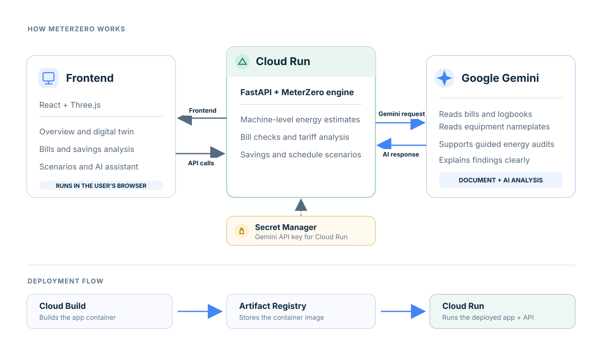

<div align="center">


### One meter. Every machine. Every product.

Energy intelligence for factories. MeterZero turns a plant's whole-site electricity data into machine- and product-level insight, checks bills, and helps teams find practical savings.

**[Open the live prototype](https://meterzero-zwb5gtsu3q-uc.a.run.app)** · **[Watch the AI Builder Cup demo](https://www.youtube.com/watch?v=furWgHMbR9c)** · **[View the architecture](docs/architecture.svg)**


</div>

---

## At a glance

Factories often receive one electricity bill for an entire site. That total hides which machines and products use the energy, when waste occurs, and whether the bill reflects actual operations. MeterZero combines a simulated plant, its schedule, and its main-meter data to estimate machine-level usage, allocate energy to products, inspect bills, and prioritize savings opportunities.

The prototype includes an interactive overview, a 3D digital twin, bill and document readers, evidence-backed savings analysis, schedule what-if scenarios, regional tariff settings, and a Gemini-powered assistant.

## Prototype and demo

- **Live application:** [meterzero-zwb5gtsu3q-uc.a.run.app](https://meterzero-zwb5gtsu3q-uc.a.run.app)
- **API health:** [/api/health](https://meterzero-zwb5gtsu3q-uc.a.run.app/api/health)
- **Gemini status:** [/api/ai/status](https://meterzero-zwb5gtsu3q-uc.a.run.app/api/ai/status)
- **Video demonstration:** [Watch on YouTube](https://www.youtube.com/watch?v=furWgHMbR9c)

## How it works

1. **Estimate energy by machine.** MeterZero learns machine load patterns from the plant schedule and whole-site meter, then reconciles machine estimates so they add up to the main meter.
2. **Connect energy to operations.** The product and schedule model attributes energy and cost across machines, production, and time-of-use periods.
3. **Find what to investigate.** Bill checks, overnight usage, schedule scenarios, and savings rankings surface actionable issues with supporting evidence.
4. **Ask Gemini.** Gemini can read bill, logbook, and equipment-nameplate photos, support energy audits with typed tools, and explain results in plain language.

Demo results use simulated plants with hidden machine meters, which lets the prototype compare its estimates with known values. They are not claims of measured performance at a live factory.

## Google services and challenge fit

**Challenge:** Manufacturing — Intelligent Operations & Industrial Efficiency. Energy efficiency and sustainability are important outcomes of the manufacturing use case.

**Google services:** Gemini powers document understanding and the energy-audit assistant. Cloud Run hosts the web application and API. Cloud Build builds the container image, Artifact Registry stores it, and Secret Manager supplies the Gemini API key to the service at runtime.

**Submission brief:** MeterZero helps manufacturers find hidden energy waste by estimating machine- and product-level electricity use from a facility's main meter. Gemini reads bills and equipment records and supports evidence-based energy audits. Cloud Run hosts the prototype, with Cloud Build, Artifact Registry, and Secret Manager supporting deployment and API-key handling.

## Architecture



The diagram shows the deployed prototype path. Plant configurations and generated results are currently file-based in the service container. For durable shared data across Cloud Run instances, a production version can add a managed data store such as Firestore.

## Run locally

### Requirements

- Python 3.12 or newer
- Node.js 20.19 or newer
- Git

### 1. Clone and install the backend

```powershell
git clone https://github.com/admiral41/MeterZero.git
cd MeterZero
python -m venv .venv
.\.venv\Scripts\Activate.ps1
python -m pip install -r backend/requirements.txt
```

On macOS or Linux, activate the virtual environment with `source .venv/bin/activate`.

### 2. Configure Gemini (optional)

Create `backend/.env` using the example file, then add a Gemini key from [Google AI Studio](https://aistudio.google.com/apikey):

```powershell
Copy-Item backend/.env.example backend/.env
notepad backend/.env
```

Set `GEMINI_API_KEY=your-key` in that local file. Never commit `.env`; it is excluded from Git and deployment uploads. The dashboard and sample analyses can run without a key; Gemini-powered features require one.

### 3. Start the backend

From the repository root:

```powershell
.\.venv\Scripts\Activate.ps1
Set-Location backend
python -m meterzero all
uvicorn server.main:app --reload --port 8000
```

The API is available at <http://localhost:8000>. Keep this terminal open.

### 4. Start the frontend

Open a second terminal at the repository root:

```powershell
Set-Location frontend
npm ci
npm run dev
```

Open <http://localhost:5173>. The Vite development server forwards `/api` requests to the backend on port 8000.

## Deploy to Google Cloud Run

Deploy from the repository root after authenticating with the Google Cloud account that has access to your project:

```powershell
gcloud auth login
.\deploy.ps1 -Project YOUR_GOOGLE_CLOUD_PROJECT_ID
```

The script enables the required Google Cloud services, builds the application with Cloud Build, stores the Gemini key in Secret Manager, and deploys the service to Cloud Run. It reads the project ID and key from `backend/.env` when available. Never commit that file or paste the key into source code.

After deployment, use the service URL printed by the script to verify the application and Gemini connection:

```text
https://YOUR_CLOUD_RUN_URL/api/health
https://YOUR_CLOUD_RUN_URL/api/ai/status
```

The health endpoint should return `ok: true`; the AI status endpoint reports whether Gemini is connected.

## Configuration

Backend settings are read from `backend/.env`:

| Variable | Purpose |
| --- | --- |
| `GEMINI_API_KEY` | Gemini API key for server-side AI features |
| `GEMINI_MODEL` | Optional Gemini model override |
| `GOOGLE_CLOUD_PROJECT` | Google Cloud project ID used by deployment tooling |
| `GOOGLE_GENAI_USE_VERTEXAI` | Set to `true` to configure Gemini through Vertex AI |

Users may also provide a Gemini key in the app's Settings page; a user-provided key is kept in that browser.

## Repository layout

```text
backend/
  meterzero/       Energy simulation, models, reconciliation, savings, and Gemini tools
  server/          FastAPI routes and application services
  tests/           Backend tests
  samples/         Demo bills, logbooks, and equipment nameplates
frontend/
  src/pages/       Overview, twin, bills, savings, scenarios, and settings
  src/twin/        Three.js digital twin and energy-flow views
  src/components/ Shared layout, navigation, and assistant UI
docs/
  architecture.svg MeterZero system architecture diagram
Dockerfile         Combined frontend/backend Cloud Run image
deploy.ps1         Windows Cloud Run deployment script
deploy.sh          macOS/Linux Cloud Run deployment script
DEMO.md            Prototype demo notes
```

## Team

**Green Mantis** · Susan Kafle · Sudin Kafle

<div align="center"><sub>Built for the Google AI Builder Cup</sub></div>
