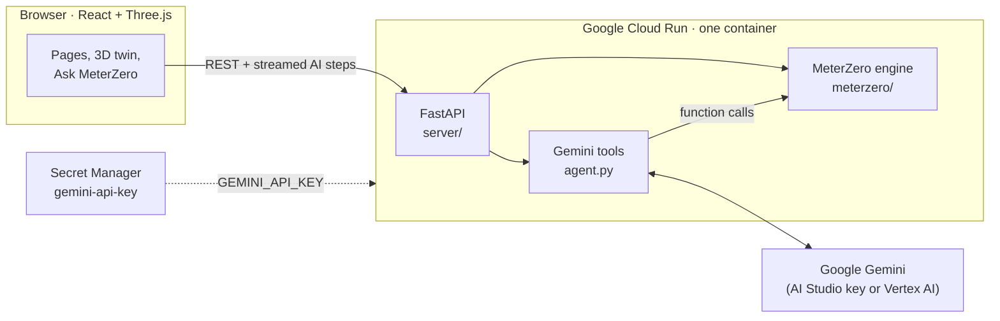

<div align="center">


### One meter. Every machine. Every product.

Energy intelligence for factories: MeterZero splits a plant's single electricity meter into every machine and
every product, checks the electricity bill line by line, and shows what to fix first. **Ask MeterZero**, the
assistant powered by **Google Gemini**, reads bills and logbooks from a photo, audits the week with the
engine's tools and explains every number.


**[Watch the AI Builder Cup prototype demo](https://www.youtube.com/watch?v=furWgHMbR9c)** · **[Deploy to Cloud Run](DEPLOY.md)**

> **Live prototype:** Add the public Cloud Run URL here after deployment.


</div>

---

## Contents

- [The problem](#the-problem)
- [What MeterZero does](#what-meterzero-does)
- [How Gemini is used](#how-gemini-is-used)
- [Architecture](#architecture)
- [Results](#results)
- [Run it locally](#run-it-locally)
- [Deploy to Google Cloud Run](#deploy-to-google-cloud-run)
- [Configuration](#configuration)
- [Project structure](#project-structure)
- [Testing](#testing)
- [Limitations](#limitations)

## The problem

Small and mid-size factories pay **one electricity bill**. They can't tell which machine or which product the
money went on, so they can't price products, find waste or report carbon per unit. Fitting a meter to every
machine is expensive, the bill itself can't be checked, and production is often still logged on paper.

## What MeterZero does

| | |
|---|---|
| **Overview** | The week's energy and bill, a morning check, what to fix first (ranked by money, with a likely range) and an animated 3D flow of every kWh from the meter to each product. |
| **Digital twin** | An editor-style 3D view (hierarchy, scene, inspector, timeline). Play the day and watch current flow to each machine; lights follow the shift; waste shows up red. Fly with W A S D, frame with F. |
| **Bills & paperwork** | Six months of bills checked line by line: charges that don't add up, power-factor surcharges, demand above usual, peak-price share, units against the meter. The bill is split by machine and by product. Gemini reads bill, logbook and nameplate photos. |
| **Find savings** | Every finding priced, with the chart behind it. Gemini can run a full energy-audit review on top. |
| **What if** | Move a production line earlier or later and see the bill, peak demand, clashes and staffing change. |
| **Ask MeterZero** | A Gemini assistant on every page that knows what's on screen, by text or voice, and shows every lookup it made. |
| **Accuracy** | Every figure compared with hidden meters on a week the model never saw. |
| **Plant designer** | Build any plant from 15 machine types, then simulate it and train MeterZero on it in about a minute. |
| **Regions** | Typical industrial time-of-use prices, currency, demand units and grid CO2 for the US (default), Canada, Japan, Australia, India and Nepal. |

<table>
  <tr>
    <td width="50%"><br /><sub><b>Overview</b>: the week and what to fix first</sub></td>
    <td width="50%"><br /><sub><b>Energy flow</b>: every kWh, meter to product</sub></td>
  </tr>
  <tr>
    <td><br /><sub><b>Bill check</b>: overcharges and surcharges found</sub></td>
    <td><br /><sub><b>Find savings</b>: priced findings with evidence</sub></td>
  </tr>
  <tr>
    <td><br /><sub><b>What if</b>: try a schedule change first</sub></td>
    <td><br /><sub><b>Accuracy</b>: checked against hidden meters</sub></td>
  </tr>
</table>

## How Gemini is used

MeterZero does the measuring; Gemini does what a language model is good at: reading messy paper, planning an
investigation, comparing options and explaining. It only ever sees the engine's tool outputs, never raw data or
the hidden meters, and every answer shows the lookups behind it.

| Gemini capability | Used for |
|---|---|
| **Function calling** | An energy audit: Gemini plans the review, calls up to 25 lookups across **15 typed tools** (tariff, waste, schedule shifts, repairs, sensors, carbon…), rejects options that clash with production and returns ranked findings |
| **Structured output** | Findings become cards with savings, ranges and confidence; photos become typed, validated fields |
| **Vision** | Electricity bills, handwritten production logbooks and machine nameplates, read from a photo |
| **Audio** | Voice questions on the shop floor |
| **Context** | The floating assistant receives what's on screen: the time and machine in the twin, the bill being checked, the change being tried |

Code: [`backend/meterzero/agent.py`](backend/meterzero/agent.py) (tools and agent),
[`backend/meterzero/vision.py`](backend/meterzero/vision.py) and [`bill.py`](backend/meterzero/bill.py) (photos),
[`backend/server/ai.py`](backend/server/ai.py) (streaming API routes).

### Firebase and Firestore

Firebase and Cloud Firestore are **not currently integrated** in this version. Plant specifications and trained
results are stored as files by the FastAPI service. The deployment guide describes the current architecture; do
not represent Firebase or Firestore as part of the submitted implementation. A future production deployment
could move user accounts and durable, shared plant data to Firebase Authentication and Firestore.

## Architecture



**The engine**, from one meter and the production schedule:

1. Gradient-boosted models learn each machine's power from the schedule and the meter's pattern.
2. A reconciliation step shares out the meter exactly, so machines always add up to what was measured.
3. Calibrated ranges ("likely between") come with every figure, per minute, per batch and per day.
4. On top: energy per product, overnight waste alerts, time-of-use pricing, schedule what-ifs, bill checks and
   advice on where the next meter pays off.

## Results

On a simulated plant with a hidden meter on every machine, measured on a week the model never saw:

| | |
|---|---|
| Accuracy from one meter | **88.1%** (spreadsheet baseline: 76.5%) |
| With 2 recommended extra meters | **95.4%** (random placement: 92.0%) |
| "Likely between" ranges: minute / batch / machine-day | 90% / 98% / 80% |
| Compressed-air leak injected mid-week | flagged every night; fixing it is worth about **$369 a month** |
| Best clash-free schedule change | line C three hours earlier: about **$179 a month** |
| Energy that made nothing | 12% of the week |
| Custom plants (bakery, garment templates) | about 90% accurate after a one-minute training run |

## Run it locally

**Requirements:** Python 3.12+, Node.js 20.19+, Git.

### 1. Install prerequisites

Install **Python 3.12+**, **Node.js 20.19+**, and Git. In PowerShell, clone the repository and create a Python
virtual environment:

```powershell
git clone https://github.com/admiral41/MeterZero.git
cd MeterZero
python -m venv .venv
.\.venv\Scripts\Activate.ps1
python -m pip install -r backend/requirements.txt
```

For macOS or Linux, activate the environment with `source .venv/bin/activate` instead.

### 2. Configure Gemini (optional, for AI features)

Create `backend/.env` from the example and add your key from [Google AI Studio](https://aistudio.google.com/apikey):

```powershell
Copy-Item backend/.env.example backend/.env
notepad backend/.env
```

Set `GEMINI_API_KEY=your-key` and save. **Never commit this file.** It is ignored by Git. The core dashboard can
run without a Gemini key; Gemini-powered assistant and document-reading features need one.

### 3. Start the backend

Open a terminal at the repository root, then run:

```powershell
.\.venv\Scripts\Activate.ps1
Set-Location backend
python -m meterzero all
uvicorn server.main:app --reload --port 8000
```

The first command simulates the demo factory and trains its model. Leave this terminal running. The API is at
<http://localhost:8000> and its health check is <http://localhost:8000/api/health>.

### 4. Start the frontend

Open a **second terminal** at the repository root:

```powershell
Set-Location frontend
npm ci
npm run dev
```

Open <http://localhost:5173>. Keep both terminals running while you use the app. The Vite development server
forwards `/api` requests to the backend on port 8000.

To run the built app through one local server, build the frontend with `npm --prefix frontend run build`, then
start `uvicorn server.main:app --app-dir backend --port 8000` from the repository root and open
<http://localhost:8000>.

## Deploy to Google Cloud Run

```powershell
gcloud auth login
.\deploy.ps1                       # reads the project and key from backend\.env  (macOS/Linux: ./deploy.sh PROJECT_ID)
```

The script enables the required services, stores the Gemini key in **Secret Manager**, and runs
`gcloud run deploy --source .`. **Cloud Build** builds the [`Dockerfile`](Dockerfile) (frontend build, then the
Python backend, then training the demo plant), and **Cloud Run** serves the app and API from one container that
scales to zero. Step by step, with troubleshooting: **[DEPLOY.md](DEPLOY.md)**.

## Configuration

All settings live in `backend/.env` (copied from [`backend/.env.example`](backend/.env.example)). It is ignored
by git, the container build and the Cloud upload.

| Variable | Purpose |
|---|---|
| `GEMINI_API_KEY` | Gemini API key from [Google AI Studio](https://aistudio.google.com/apikey) |
| `GEMINI_MODEL` | Optional: which Gemini model to use |
| `GOOGLE_CLOUD_PROJECT` | Project ID or number, used by `deploy.ps1` |
| `GOOGLE_GENAI_USE_VERTEXAI` | `true` to use Gemini through Vertex AI instead of a key |

Users can also paste their own key in **Settings**; it stays in their browser.

## Project structure

```
backend/
  meterzero/        the engine: simulation, models, reconciliation, savings, bills, regions, Gemini tools
  server/           FastAPI: main.py (plants, views) · ai.py (Gemini) · prices.py · paperwork.py · store.py
  tests/            backend test suite, including a fake Gemini client
  scripts/          make_samples.py · make_bills.py · live_gemini_check.py
  samples/          logbook and nameplate photos; six months of sample bills per region
frontend/
  src/pages/        one file per page; paperwork/ holds the bill, logbook and nameplate readers
  src/twin/         Three.js scenes (plant twin, energy flow) and the twin's editor panels
  src/components/   layout, sidebar, Ask MeterZero dock, shared UI
  src/lib/          API client, formatting, shared hooks
Dockerfile · deploy.ps1 · deploy.sh · DEPLOY.md
```

## Testing

```powershell
cd backend
pytest                                             # engine, API, bills, regions, and Gemini agent (fake client)
python scripts/live_gemini_check.py                # the AI features against the real Gemini API, with a report
python -m pyflakes meterzero server scripts tests  # lint
npm --prefix ../frontend run lint                  # frontend lint; `run build` type-checks
```

## Limitations

- The results come from **simulated plants** with hidden meters, so every figure can be checked. Real plants are messier.
- Training needs a few weeks of sub-metered history; a new site needs temporary meters for that time.
- Look-alike cycling loads (chiller, compressor, dryer) cause most of the error, which is why the meter advice targets them.
- Regional prices are typical examples, not a published tariff, until a real bill is loaded.
- Gemini's wording varies between runs; its numbers come from the tools and are always shown.
- Firebase Authentication and Cloud Firestore are not implemented. User data and custom plants are not backed by
  a managed, shared database; Cloud Run instance storage is not a durable persistence layer.

<div align="center"><sub>Built for the Google AI Builder Cup · Manufacturing and Sustainability</sub></div>
